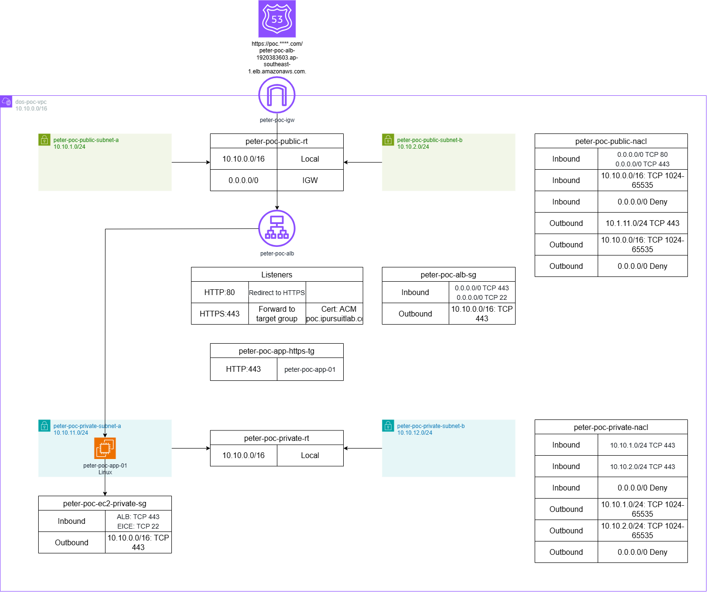
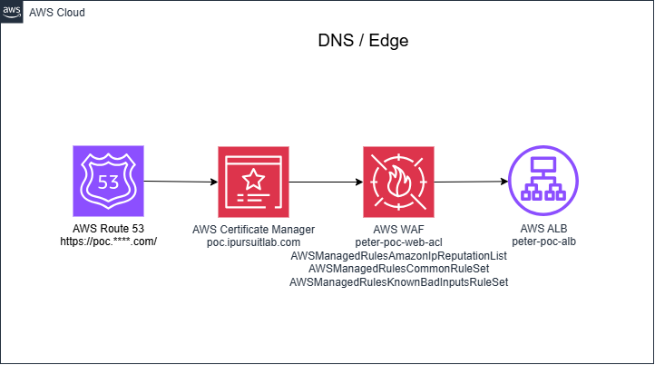
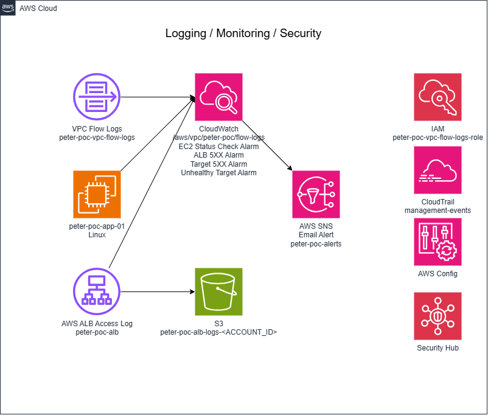
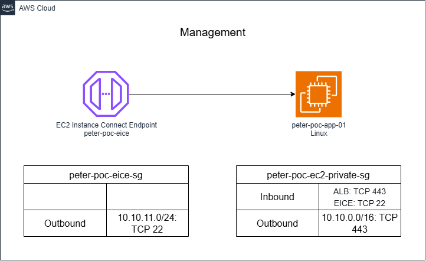

# AWS Secure POC (Terraform)

A security-focused proof-of-concept AWS environment built with Terraform. The goal of this POC is not just "make it work," but to demonstrate practical AWS security baseline controls in a small, reviewable footprint: least-privilege network design, encrypted edge termination, centralized logging, and automated alerting.

## Architecture



- **VPC** with 2 public + 2 private subnets across 2 Availability Zones
- **Public tier**: Application Load Balancer only (HTTPS termination via ACM, HTTP→HTTPS redirect)
- **Private tier**: EC2 application instance, no public IP, no inbound SSH — access is via [EC2 Instance Connect Endpoint](diagrams/app.png) instead of a bastion host
- **Edge/DNS**: Route53 + ACM for the domain, WAF in front of the ALB



- **Logging & Monitoring**: VPC Flow Logs → CloudWatch, ALB access logs → S3, CloudWatch Alarms (EC2 status check, ALB 5XX, target 5XX, unhealthy target) → SNS email alerts
- **Security posture**: AWS Config, CloudTrail management events, Security Hub





## Structure

```
.
├── network.tf              # VPC, subnets, route tables, default SG
├── security.tf             # Private EC2 security group
├── nacl.tf                 # Network ACLs
├── alb.tf                  # ALB, target group, HTTP→HTTPS listener
├── acm.tf                  # ACM certificate + DNS validation
├── route53.tf               # Route53 alias record for the ALB
├── waf.tf                  # WAFv2 web ACL for the ALB
├── compute.tf               # Private EC2 application instance
├── eice.tf                 # EC2 Instance Connect Endpoint
├── iam.tf                  # Instance IAM role (SSM managed)
├── alb-logs.tf              # S3 bucket + policy for ALB access logs
├── flowlogs.tf              # VPC Flow Logs + IAM role/policy
├── cloudwatch-alarms.tf     # CloudWatch alarms
├── sns.tf                  # SNS topic + email subscription for alerts
├── outputs.tf
├── variables.tf
├── versions.tf
├── providers.tf
└── diagrams/                # Architecture diagrams (draw.io source + PNG export)
```

## Usage

1. Copy the example variables file and fill in your own values:
   ```
   cp terraform.tfvars.example terraform.tfvars
   ```
   | Variable | Description |
   |---|---|
   | `app_ami_id` | AMI ID for the private application instance |
   | `owner_email` | Email used for resource tagging and SNS alert subscription |
   | `route53_zone_id` | Route53 hosted zone ID for your domain |
   | `domain_name` | Domain name to attach to the ALB (ACM cert + Route53 record) |

2. Initialize and apply:
   ```
   terraform init
   terraform plan
   terraform apply
   ```

`terraform.tfvars` is gitignored — never commit it, since it holds your real account-specific values.

## Notes

This is a POC, not a production baseline. It demonstrates the security controls above, but things like multi-account separation, backup/DR, and full Security Hub control coverage are out of scope.
